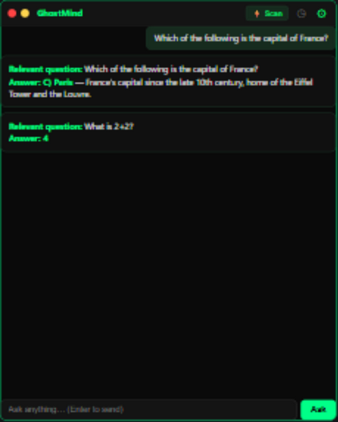
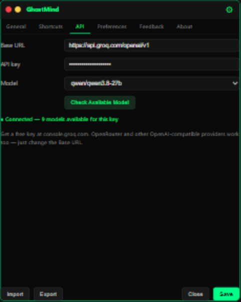
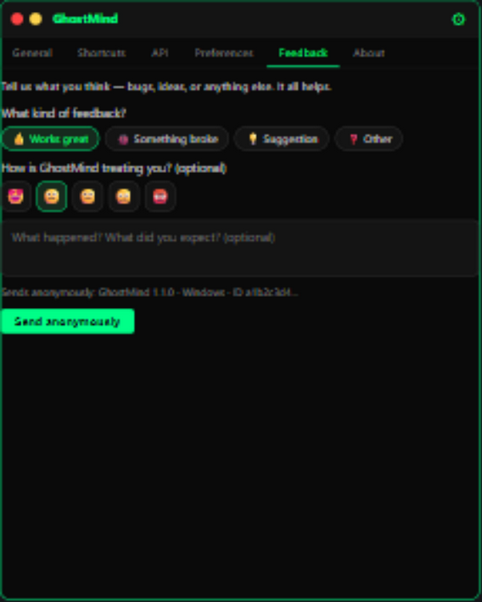
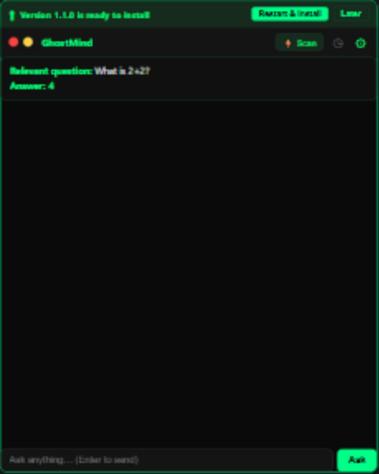

<p align="center">
  
</p>

<p align="center">
  <a href="https://github.com/dasunjlk/GhostMind/releases/latest"></a>
  &nbsp;
  <a href="https://github.com/dasunjlk/GhostMind/actions/workflows/ci.yml"></a>
  &nbsp;
  
  &nbsp;
  
  &nbsp;
  <a href="LICENSE"></a>
</p>

# GhostMind

GhostMind is a **stealth AI overlay** for Windows. It stays above other windows as a semi-transparent, frameless panel that is hidden from the taskbar and Alt+Tab, and is excluded from most screen-capture APIs so it stays off Zoom, Teams, OBS, and similar tools (OS-dependent). It can OCR the selected monitor and answer what it finds, or you can simply type a question — answers stream from **any OpenAI-compatible provider** (Groq, OpenRouter, and more).

## Screenshots

| Ask anything | Any provider | Send feedback |
|---|---|---|
|  |  |  |
| *Streamed answers with session memory* | *Base URL + key → Check Available Model* | *Anonymous, privacy-safe* |

| Updates | What's New |
|---|---|
|  |  |
| *Auto-downloaded, one click to install* | *Plain-language release notes* |

## Features

- Always-on-top, draggable, resizable overlay with custom edge handles
- Windows extended styles: tool window (no taskbar / Alt+Tab entry), optional click-through
- `SetWindowDisplayAffinity(WDA_EXCLUDEFROMCAPTURE)` for capture exclusion; optional `DWMWA_CLOAK` via settings
- Screen capture across monitors (`mss`) + Tesseract OCR + optional OpenCV preprocessing — **the question is isolated from page noise before answering**
- **Any OpenAI-compatible provider**: enter a Base URL + API key, then **Check Available Model** loads the models your key can use (default: Groq's **qwen3.8-27B**; backups **qwen3.6-27B**, **gpt-oss-120B**, **gpt-oss-20B**)
- Deterministic answers (`temperature=0.0` + fixed seed): the same question gives the same answer
- **Session memory**: while the app is open it remembers your earlier questions and answers; closing the app wipes it — nothing is saved to disk
- **Rapid-fire friendly**: questions queue up and are answered in order — none are lost
- **Guided tour**: first launch walks you through every setting, step by step (replay anytime from Settings → About)
- **In-app feedback**: praise, bugs, and ideas go straight to the developer — anonymous and privacy-safe
- Global hotkeys via the `keyboard` library
- System tray icon (show/hide; send feedback; quit)
- Settings import/export (JSON)
- Auto-start on Windows login
- File logging with rotation (`ghostmind.log`)
- **Easy updates**: availability appears as a small in-app banner, the new version downloads itself in the background, and one click installs — plus a plain-language **What's New** popup
- Anonymous error reporting **and feedback** to Sentry (scrubbed; no transcripts, questions, usernames, or hostnames — disable with `GHOSTMIND_NO_TELEMETRY=1`)
- Startup dependency check with friendly warnings
- Keyboard navigation (Escape, Tab, Backtab)
- Settings stored in `settings.toml` (installed builds use `%LOCALAPPDATA%\GhostMind\data`; source runs use `config/settings.toml`)

> **v1.0 scope:** screen-scan answers and typed questions. Audio capture
> (subtitles/meeting answers) and transcript export are fully built but hidden in
> v1.0 and return in a future update — their UI, hotkeys (`Ctrl+Shift+T` /
> `Ctrl+Shift+E`), and settings rows are reserved accordingly.

## Prerequisites

**Installed builds** (the Windows installer): nothing but the installer itself — Tesseract OCR is **bundled**, so screen scanning works out of the box.

**Running from source:**

- **Windows 10 (2004+)** recommended for `WDA_EXCLUDEFROMCAPTURE` capture exclusion
- **Python 3.11+**
- **Tesseract OCR** installed and on `PATH` (or configure `pytesseract` to point at `tesseract.exe`)

  Install example (Chocolatey): `choco install tesseract`
  Or download from: https://github.com/UB-Mannheim/tesseract/wiki

- **An API key** from any OpenAI-compatible provider — free tier at [console.groq.com](https://console.groq.com). Paste it in the app under **Settings → API** (stored securely in Windows Credential Manager), or set `GROQ_API_KEY` in `.env` as a fallback for the default Groq endpoint.

### Audio (hidden in v1.0)

The audio stack (faster-whisper, CTranslate2, sounddevice) stays in `requirements.txt` for
source development, but is **not bundled** in installed builds while the feature is hidden.
`faster-whisper` can use CUDA via a CUDA-enabled CTranslate2 build; the default is CPU `int8`.

## Installation

```text
git clone <your-fork-or-repo-url> GhostMind
cd GhostMind
python -m venv .venv
.venv\Scripts\activate
pip install -r requirements.txt
```

Then launch the app: the first run opens **Settings → API** — pick a provider (Base URL), paste your key, press **Check Available Model**, choose a model, and **Save**. Keys are stored per provider in Windows Credential Manager (with a plaintext `settings.toml` fallback if keyring is unavailable). Optionally, `copy .env.example .env` and set `GROQ_API_KEY` there instead (default Groq endpoint only).

### Fonts (optional)

For the intended look, place **JetBrains Mono**, **Inter**, or **DM Sans** under `assets/fonts/` (`.ttf` / `.otf`). If they are missing, the UI falls back to **Segoe UI** / **Consolas**.

### Run

```text
python main.py
```

GhostMind checks for missing dependencies on startup and shows a non-blocking banner if anything is unavailable. The app still starts — just with reduced functionality. First-time users get a short guided tour through every setting.

### Windows installer (end users)

Grab `GhostMind-Setup-<version>.exe` from the
[Releases page](https://github.com/dasunjlk/GhostMind/releases) and run it —
per-user install (`%LOCALAPPDATA%\GhostMind`), no admin rights needed. The
installer is **unsigned**, so Windows SmartScreen may show "Windows protected
your PC" — choose *More info → Run anyway*. Optional checkboxes: desktop
shortcut (on by default) and "Start with Windows".

Install size: the installer bundles everything GhostMind needs — including
Tesseract OCR — so there is nothing else to download or install. The dormant
audio-transcription stack is not shipped while that feature is hidden, which
keeps the package roughly half the size it would otherwise be. Release pages
list the exact download sizes.

Uninstalling removes the app files but keeps `%LOCALAPPDATA%\GhostMind\data`
(settings, update state, anonymous ID, logs), so reinstalling preserves your setup.

### Lint & tests (development)

```text
pip install -r requirements-dev.txt
ruff check .
pytest -q
```

## Usage

### Guided tour

The first launch walks you through the app with step-by-step highlights: open Settings, then every visible tab (the **API tab gets the deepest coverage** — Base URL, key, model, verification, saving), then the home-screen controls (Scan, click-through, ask box). While the tour runs, only the highlighted control is clickable. **Replay it anytime: Settings → About → Replay tutorial.**

### Asking questions

- ⚡ **Scan** (or `Ctrl+Shift+S`): GhostMind reads the screen, isolates the actual question from page noise (cookie banners, navigation, URLs), and answers it.
- **Ask box** (or `Ctrl+Shift+Q`): type any question at the bottom and press Enter — no scanning needed.
- Questions queue up: ask several in a row and each gets its own answer, in order.
- **Session memory**: within one app run, follow-up questions remember what you already asked. **Clear** (or `Ctrl+Shift+C`) wipes the visible answers *and* the memory; closing the app wipes everything.

All hotkeys:

| Action | Default hotkey |
|--------|----------------|
| Toggle overlay visibility | `Ctrl+Shift+G` |
| Trigger screen OCR + AI | `Ctrl+Shift+S` |
| Clear answers | `Ctrl+Shift+C` |
| Switch Answers ↔ Subtitles tab *(hidden in v1.0)* | `Ctrl+Shift+T` |
| Export transcript *(hidden in v1.0)* | `Ctrl+Shift+E` |
| Toggle click-through mode | `Ctrl+Shift+X` |
| Focus the question input box | `Ctrl+Shift+Q` |

### Preferences

Under **Settings → Preferences** you can set the app's **font size** (9–24 pt) — it applies to answers, subtitles, the question input, and the general UI, including already-rendered answers. More appearance options will land here in future updates.

### Feedback

**Settings → Feedback** (or tray → **Send feedback…**): pick what it is (works great / broke / suggestion / other), optionally rate, add details, and send — anonymous and scrubbed like error reports, with an optional email if you want a reply. If anonymous reporting is disabled, the tab offers a copy-to-clipboard fallback for GitHub issues.

### Audio capture quick toggles *(hidden in v1.0)*

Next to the Scan button, two small icons will let you enable/disable audio sources without opening Settings — click to toggle:

- 🎙 **Microphone capture** — shows a red slash when off (Zoom-style); if your system has no microphone at all, the icon shows an amber "❗" warning badge instead
- 🔊 **System audio capture** — same slash treatment

Both icons and the audio pipeline ship hidden in v1.0 (see v1.0 scope above).

### Keyboard Navigation

| Key | Action |
|-----|--------|
| `Escape` | Close settings (if open) or hide overlay |
| `Tab` | Cycle to next tab |
| `Shift+Tab` | Cycle to previous tab |

### Tabs

- **Answers** tab: shows streamed AI answers with copy per block.
- **Subtitles** tab *(hidden in v1.0)*: rolling transcript (`Mic:` / `System:`). Lines containing `?` or question keywords schedule a short debounce, then the recent transcript is sent to the AI as **meeting** context.

### System Tray

The GhostMind icon lives in the system tray. Right-click for:
- Show/Hide overlay
- Settings…
- Send feedback…
- Click-through toggle
- Export transcript *(hidden in v1.0)*
- Quit

Double-click the tray icon to toggle overlay visibility.

### Settings

Click the **⚙ gear** in the header to open settings:
- **General**: monitor selection, scan mode (manual/auto) + interval, opacity, click-through
- **Shortcuts**: all seven hotkeys, remappable
- **API**: Base URL (provider), API key, model selector, **Check Available Model** — the app verifies your credentials and lists the models your key can use
- **Preferences**: font size
- **Feedback**: send the developer praise, bugs, and ideas
- **About**: version, GitHub link, Replay tutorial

Plus Import/Export settings (JSON) and **Save** at the bottom. Audio settings (mic/system, Whisper model) and the "Subtitles on Startup" row are present but hidden in v1.0 (see v1.0 scope above).

### Export *(hidden in v1.0)*

Save the full meeting transcript via:
- `Ctrl+Shift+E` hotkey
- "Save" button in the Subtitles tab
- Tray menu → "Export transcript"

Choose `.txt` (plain text) or `.md` (markdown with timestamps and formatting).

## Configuration (`settings.toml`)

Installed builds store it at `%LOCALAPPDATA%\GhostMind\data\settings.toml`; when running from source it is `config/settings.toml`. Set `GHOSTMIND_DATA_DIR` to override the data directory (QA/tests). Created when you click **Save** in settings. Keys include:

| Key | Meaning |
|-----|---------|
| `monitor_id` | `mss` monitor index (1 = first physical monitor) |
| `scan_mode` | `manual` or `auto` |
| `auto_scan_interval_sec` | Seconds between OCR runs when `auto` |
| `opacity` | Window opacity `0.5`–`1.0` |
| `click_through` | If true, `WS_EX_TRANSPARENT` so clicks pass through |
| `dwm_cloak` | If true, applies `DWMWA_CLOAK` (default false) |
| `font_size` | Base UI text size, 9–24 pt |
| `api_base_url` | OpenAI-compatible endpoint (default: Groq `https://api.groq.com/openai/v1`) |
| `ai_model` | Model ID for the current provider |
| `custom_models` | Manually typed model IDs, kept in the dropdown |
| `tutorial_done` | Set once the first-run guided tour is completed |
| `subtitles_enabled` | Start Whisper listeners on launch |
| `capture_mic` | Capture microphone |
| `capture_system` | Capture WASAPI loopback when available |
| `whisper_model` | `tiny` / `base` / `small` / `medium` |
| `loopback_device` | Optional integer sounddevice index; `null` = auto-detect |
| `hotkeys.*` | Combo strings for all actions |

Hotkey strings follow the `keyboard` library format (e.g. `ctrl+shift+g`). API keys are
**not** in this file — they live in Windows Credential Manager, one slot per provider
(with a plaintext fallback only if keyring is unavailable).

The listening keys (`subtitles_enabled`, `capture_mic`, `capture_system`,
`whisper_model`, `loopback_device`) are reserved for the future audio update and
stay inactive in v1.0. Window position/size is also persisted here
(`window_x/y/w/h`, `window_screen`).

## Updates

GhostMind checks GitHub **once at launch and every 6 hours** while running (cached — never more than one check per 6h window, even across restarts).

- **Update available** → a small **banner** appears inside the app: *What's New* (plain-language bullets, no markdown mess), *Update*, and *Later* (snoozes 24h).
- **Automatic download**: once you've been notified, the new installer downloads itself in the background into the app's own data folder (`%LOCALAPPDATA%\GhostMind\data\updates\` — never your Downloads folder), SHA-256 verified against `SHA256SUMS.txt`. The banner then reads **"Restart & install"** — one click runs the installer and closes GhostMind; start GhostMind again when it finishes.
- **After the 5-day grace period** the popup can no longer be closed and the update must be installed.
- **Safety valve:** if downloads keep failing after the grace period (e.g. GitHub is unreachable), a **Continue for 24 hours** option appears — it re-locks after 24h. A machine that is fully offline is never locked out.
- Fully automatic: update checking contacts only GitHub. Separately, **anonymous error reports and feedback** (scrubbed, identified only by a random local UUID) are sent to Sentry so bugs can be fixed in future releases — see **Security & ethics** to opt out.

QA/testing hooks (dev only): `GHOSTMIND_UPDATE_URL` (point at another releases URL, `file://` JSON works), `GHOSTMIND_FORCE_UPDATE=1`, `GHOSTMIND_GRACE_DAYS=0`, `GHOSTMIND_TESSERACT_DIR` (bundled-OCR path override).

## Troubleshooting

- **Empty OCR / scan finds nothing**
  Installed builds bundle Tesseract, so this is rare — check the log file. Running from source? Install Tesseract and ensure `tesseract` is on `PATH`; GhostMind shows a non-blocking banner if it's missing.

- **Invalid / missing API key or model**
  **Settings → API**: check the Base URL (most providers need the `/v1` path), re-paste the key, press **Check Available Model** — the app tells you exactly what's wrong (key rejected, unreachable host, out of credit, unknown model) instead of a generic error. Keys are stored per provider in Windows Credential Manager. Free keys at the [Groq console](https://console.groq.com); OpenRouter keys work via `https://openrouter.ai/api/v1`.

- **Answers changed between identical questions** — fixed in v1.1.0 (deterministic temperature + seed). If it still happens on a custom provider, the provider may not honor `seed`.

- **No microphone or loopback device**
  Grant microphone permission on Windows. Loopback requires a WASAPI loopback-capable device; if none is found, only mic capture runs. *(Audio is hidden in v1.0.)*

- **Global hotkeys not firing**
  The `keyboard` library on Windows may need **Run as administrator** for low-level hooks in some environments.

- **Window still visible in a specific recorder**
  Capture exclusion depends on the app honoring `WDA_EXCLUDEFROMCAPTURE`. Some tools or GPU drivers may behave differently.

- **Check the log file**
  GhostMind writes detailed logs to `ghostmind.log` (rotating, 1MB x 3 backups) in `%LOCALAPPDATA%\GhostMind\data` for installed builds, or the repository root when running from source. Check this file for crash diagnostics.

## Architecture

```text
+------------------------------------------------------------------+
|                          main.py                                 |
|  QApplication, settings load/save, SIGINT, GhostMindController   |
|  System tray, dependency check, file logging, update/feedback    |
+----------+--------------+-------------------+--------------------+
           |              |                   |
           v              v                   v
+----------------+  +------------------+  +------------------+
| HotkeyManager  |  |  AudioListener   |  |  System Tray     |
| (keyboard lib) |  |  (QThread + STT, |  |  (QSystemTray)   |
|                |  |  hidden v1.0)    |  |                  |
+--------+-------+  +---------+--------+  +------------------+
         |                    |
         | signals            | subtitle_updated (dormant)
         v                    v
+-------------------------------------------------------------+
|                     OverlayWindow (QMainWindow)             |
|  stealth.apply_stealth(hwnd) on show / move / resize        |
|  + Header (drag) + Tabs + Settings + banners + tutorial     |
+-------+------------------------------------+----------------+
        |                                    |
        v                                    v
 +-------------+                     +---------------+
 | AnswerPanel |                     | SessionMemory |
 | + AI queue  |                     | (per-session) |
 +------+------+                     +---------------+
        |
        v
 +-------------+     +--------------------------------+
 | AiStream    |<--->| OpenAI-compatible provider     |
 | Worker      |     | (Groq / OpenRouter / ...)      |
 +-------------+     +--------------------------------+

 +------------------+       +---------------------------+
 | ScreenScanWorker | ----> | mss + pytesseract         |
 | (with question   |       | (+ screen_focus isolate)  |
 |  isolation)      |       +---------------------------+
 +------------------+

 +-------------------+     +------------------------------+
 | utils/updater     | --> | banner -> auto-download      |
 |                   |     | -> one-click install         |
 +-------------------+     +------------------------------+

 +-------------------+     +------------------------------+
 | utils/feedback    | --> | Sentry feedback (scrubbed,   |
 |                   |     | anonymous, offline outbox)   |
 +-------------------+     +------------------------------+

 +------------------+       +-------------------+
 | utils/autostart  | ----> | Windows Registry  |
 +------------------+       +-------------------+

 +------------------+       +-------------------+
 | utils/config_io  | ----> | JSON import/export|
 +------------------+       +-------------------+
```

## Project Structure

```text
GhostMind/
├── main.py                 # Entry point, controller, tray, logging, updates, feedback flush, tutorial trigger
├── core/
│   ├── ai_engine.py        # Provider-agnostic streaming + prompt routing (base_url, temperature=0, seed)
│   ├── audio_listener.py   # Mic/system capture + faster-whisper STT (hidden in v1.0; not bundled)
│   ├── screen_reader.py    # mss screenshot + Tesseract OCR (+ bundled-OCR resolution)
│   ├── screen_focus.py     # OCR noise filtering / on-screen question isolation
│   ├── session_memory.py   # In-process conversation memory (wiped on exit)
│   ├── question_detect.py  # Question keyword detection (transcripts)
│   └── stealth.py          # Win32 stealth (hide from capture/taskbar)
├── ui/
│   ├── overlay_window.py   # Main frameless window (drag, resize, tabs, tour host)
│   ├── answer_panel.py     # Scrollable answer history with markdown
│   ├── subtitle_bar.py     # Live transcript ticker (hidden in v1.0)
│   ├── settings_panel.py   # In-overlay settings (General/Shortcuts/API/Prefs/Feedback/About)
│   ├── feedback_panel.py   # In-app user feedback tab (C13)
│   ├── tutorial.py         # Guided first-run tour (coach-marks, C14)
│   ├── update_banner.py    # In-app update banner (C6)
│   ├── update_popup.py     # What's New popup + forced-update lock (U-01)
│   ├── dependency_banner.py# Non-blocking startup warnings
│   └── click_through_banner.py # Click-through indicator/recovery
├── utils/
│   ├── app_paths.py        # Data-dir resolution + legacy migration
│   ├── formatter.py        # Markdown → HTML renderer
│   ├── hotkey_manager.py   # Global hotkeys
│   ├── autostart.py        # Windows auto-start (registry)
│   ├── config_io.py        # Settings import/export (JSON)
│   ├── key_store.py        # Per-provider API key storage (Windows Credential Manager)
│   ├── updater.py          # Update check, banner/auto-download state, SHA-256 verify
│   ├── whatsnew.py         # Release-notes → plain-language What's New bullets
│   ├── feedback.py         # In-app feedback channel (Sentry + offline outbox)
│   └── error_reporter.py   # Anonymous error reporting (Sentry)
├── tests/                  # pytest suite (offline; no network)
├── assets/
│   ├── icon_src.svg        # Icon design source
│   ├── icon.ico            # Window/tray/exe icon (multi-size)
│   ├── icon_256.png        # Tray asset
│   ├── installer/          # Wizard side art + Tesseract notice
│   └── fonts/              # Optional custom fonts
├── installer/
│   └── ghostmind.iss       # Branded Inno Setup script (+ bundled OCR)
├── scripts/
│   └── generate_icons.py   # SVG → icon.ico/wizard art (dev tool)
├── config/                 # Source-run runtime settings (gitignored)
├── ghostmind.spec          # PyInstaller onedir build spec (audio excluded)
├── .github/workflows/      # CI + release automation
├── requirements.txt
└── ghostmind.log           # Source-run rotating log (gitignored)

Installed builds keep settings, update state, the anonymous ID, feedback
outbox, downloaded installers, and logs in %LOCALAPPDATA%\GhostMind\data
instead of the install directory.
```

## Security & ethics

**Anonymous error reporting and feedback.** GhostMind sends crash/error reports — and, when you choose, in-app feedback — to Sentry. Both are scrubbed before sending: no transcripts, questions, window contents, API keys (`gsk_…`/`sk-…` patterns are masked), usernames, hostnames, or home-directory paths; each install is identified only by a random UUID stored in the local data directory (`config/anonymous_id.txt` from source, `%LOCALAPPDATA%\GhostMind\data\config\anonymous_id.txt` when installed). Feedback text you type is scrubbed with the same rules, an optional reply email is used only if you provide it, and failed sends stay in a local outbox until they can be delivered. Disable everything anytime with the environment variable `GHOSTMIND_NO_TELEMETRY=1` — the app then never contacts Sentry and the feedback tab says so honestly. Maintainer QA hooks: `GHOSTMIND_SENTRY_DSN`, `GHOSTMIND_TEST_ERROR=1`.

**API keys** are stored in Windows Credential Manager, one slot per provider host, and are never written to settings exports. Fallback plaintext storage (only if keyring is unavailable) stays in the local data directory.

GhostMind is built for legitimate personal productivity (e.g. private assistance during your own calls or content). **Bypassing exam proctoring, workplace policy, or consent rules is misuse.** You are responsible for compliance with laws, contracts, and platform terms.

## License

See `LICENSE` in the repository.
