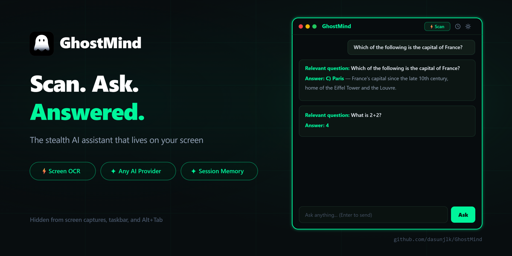
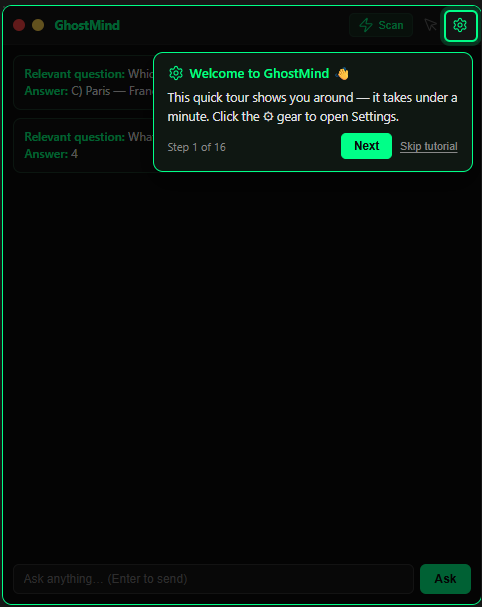
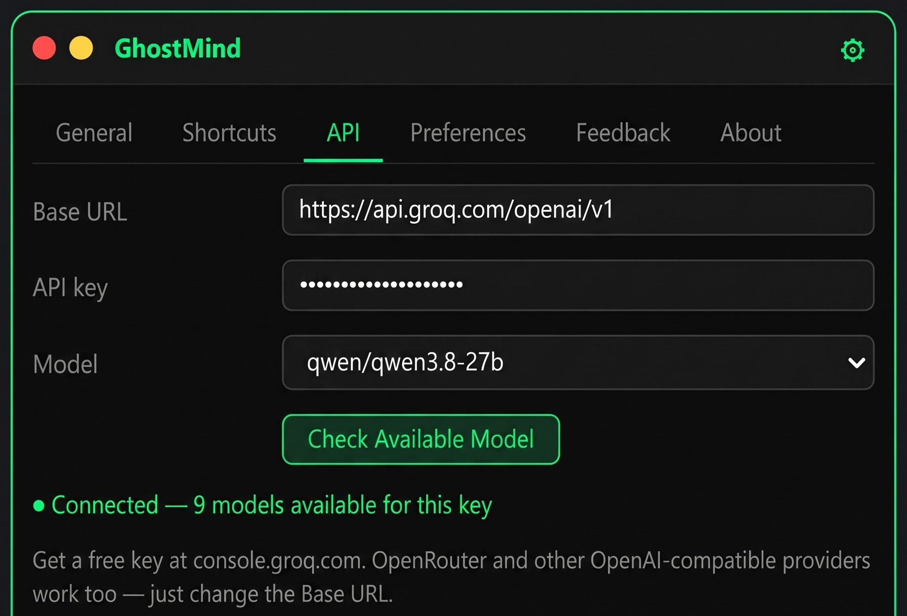
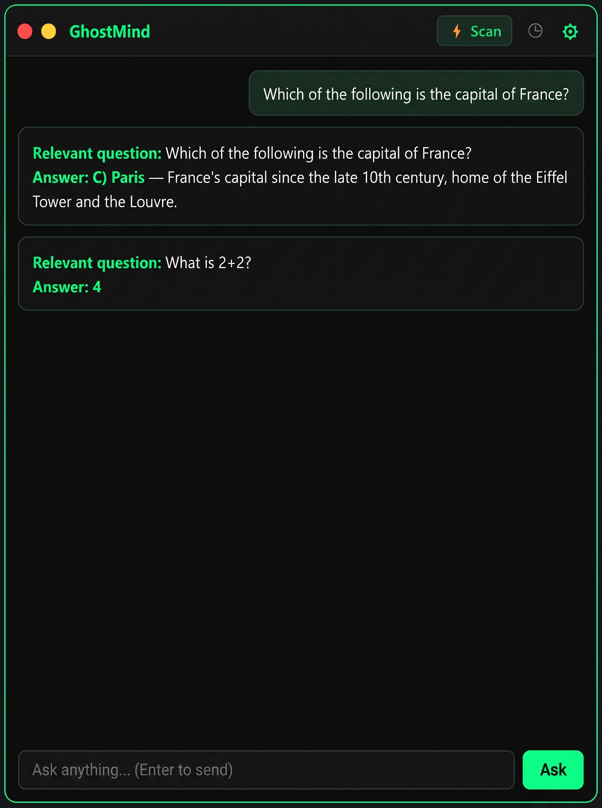
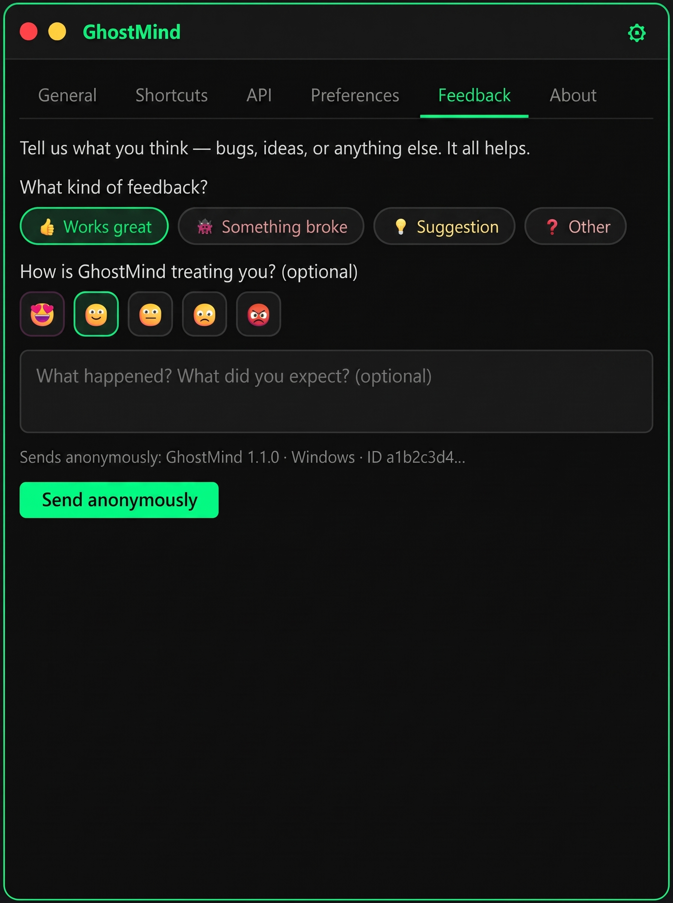
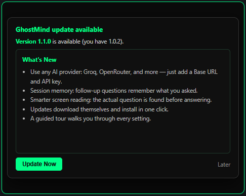
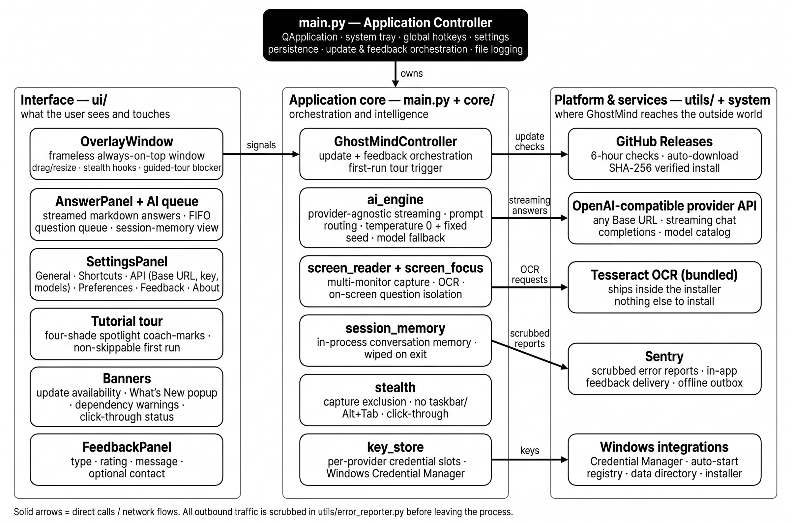

<p align="center">
  
</p>

<p align="center">
  <a href="https://github.com/dasunjlk/GhostMind/releases/latest"></a>
  &nbsp;
  <a href="https://github.com/dasunjlk/GhostMind/actions/workflows/ci.yml"></a>
  &nbsp;
  
  &nbsp;
  
  &nbsp;
  <a href="LICENSE"></a>
</p>

# GhostMind

GhostMind is a **stealth AI assistant** for Windows. It lives on your screen as an always-on-top overlay that is hidden from the taskbar and Alt+Tab and excluded from most screen capture APIs, so it never shows up in Zoom, Teams, or OBS. Read something on your screen and want an answer? Press one hotkey - GhostMind finds the actual question and answers it. Or just type a question. Answers stream from **any OpenAI-compatible AI provider** you choose.

## Why GhostMind

- 🕶 **Truly stealth** - excluded from screen captures, no taskbar or Alt+Tab entry, optional click-through mode, drag-and-resize overlay
- 🔌 **Your provider, your choice** - any OpenAI-compatible endpoint works: cloud services, OpenRouter, even local servers on your own machine
- 🎯 **Understands your screen** - OCR finds the real question on a busy page instead of being distracted by banners and menus
- 💬 **Remembers the conversation** - session memory keeps context across questions; closing the app wipes it completely
- 🛡 **Private by design** - error reports and feedback are scrubbed before sending and identified only by a random ID; opt out anytime
- 🧭 **Zero learning curve** - a guided tour walks you through every setting on first run, replayable anytime
- ⚡ **Stays out of your way** - global hotkeys, click-through mode, per-monitor capture, streamed answers sized to your window

## Features

- 📖 **Screen scan** - reads any monitor, filters out page noise (cookie banners, navigation, URLs), and answers the actual question
- ⌨️ **Ask box** - type anything, no scanning needed, with streamed markdown answers
- 🔌 **Any OpenAI-compatible provider** - Base URL + API key is all it takes; verify your credentials and see the models your key can use
- 💬 **Session memory** - follow-up questions remember the conversation within one app run; wiped completely on close
- 🔁 **Rapid-fire friendly** - questions queue up and are answered one by one, never lost
- 🎲 **Deterministic answers** - the same question gives the same answer
- 🖱 **Click-through mode** - let clicks pass through the overlay whenever you only want to look
- ⌨️ **Remappable global hotkeys** - every action, from anywhere in Windows
- 🖥 **Per-monitor capture** - choose which screen to scan
- 📏 **Adaptive text** - font size 9-24 pt applied across the whole app
- 📣 **In-app feedback** - tell the developer what you think, anonymously
- 🚀 **Effortless updates** - a banner tells you when a new version exists, it downloads itself, one click installs
- 🧭 **Guided tour** - learn the whole app in under a minute on first run

## Usage

### Getting started

1. Download `GhostMind-Setup-<version>.exe` from the
   [Releases page](https://github.com/dasunjlk/GhostMind/releases) and run it -
   per-user install, no admin rights needed. (The installer is unsigned, so
   SmartScreen may show a warning - choose *More info → Run anyway*.)
2. The in-app **guided tour** walks you through every setting on first
   launch - including connecting your provider - so no setup knowledge is
   needed. Replay it anytime from **Settings → About**.
3. Open **Settings → API**, paste the API key from your provider, press
   **Check Available Model**, pick a model, **Save**. Done.

Everything ships inside the installer, so there is nothing else to download
or install. Uninstalling keeps your settings and keys
(`%LOCALAPPDATA%\GhostMind\data`), so reinstalling preserves your setup.

| | |
|---|---|
| **Requirements**: Windows 10/11 (64-bit) · an API key from any OpenAI-compatible provider · internet for AI answers · ~250 MB disk space. **Nothing else** - the OCR engine ships inside the installer. | |

### Guided Tour

The first launch starts a **step-by-step tour** with a spotlight: each banner highlights one control, and only that control is clickable while the rest of the app dims. It covers the home screen, every settings tab (the API tab gets the deepest coverage), and the home-screen features - finishing with a **Done** button on the last step.

| | |
|---|---|
| The first run cannot be skipped, so nobody accidentally misses it - and it can be replayed anytime from **Settings → About → Replay tutorial**.<br><br>**Availability**: the tour starts automatically on first launch and can be replayed from Settings → About at any time. |  |


### Choose your AI provider

GhostMind speaks the OpenAI-compatible API, so most AI services work by entering three things in **Settings → API**:<br><br>
1. **Base URL** - your provider's API address
2. **API key** - stored securely in Windows Credential Manager, one slot per provider
3. **Check Available Model** - verifies your credentials and lists the models your key can use; pick one or type any model ID.

<p align="center">
   
</p>

| Provider | Base URL | Notes |
|---|---|---|
| **Preconfigured default** | already set - just add your key | ships ready to use |
| **OpenRouter** | `https://openrouter.ai/api/v1` | hundreds of models behind one key |
| **Local servers** (LM Studio, Ollama, …) | `http://localhost:<port>/v1` | fully offline, your hardware |
| **Any OpenAI-compatible service** | from the provider's docs | most services need the `/v1` path |

If something is wrong, GhostMind tells you **exactly** what: key rejected,
unreachable host, out of credit, or an unknown model - never a generic error.

### Asking GhostMind

| | |
|---|---|
| ⚡ **Scan** (or `Ctrl+Shift+S`): reads the screen, isolates the actual question from page noise, and answers it.<br><br>**Ask box** (or `Ctrl+Shift+Q`): type any question and press Enter - no scanning needed.<br><br>Questions **queue up**: ask several in a row and each gets its own answer, in order.<br><br> |  |

**Session memory**: follow-ups remember what you already asked. **Clear** (`Ctrl+Shift+C`) wipes the answers and the memory; closing the app wipes everything.

Global hotkeys (all remappable in **Settings → Shortcuts**):

| Action | Default hotkey |
|--------|----------------|
| Toggle overlay visibility | `Ctrl+Shift+G` |
| Trigger screen scan | `Ctrl+Shift+S` |
| Clear answers | `Ctrl+Shift+C` |
| Toggle click-through mode | `Ctrl+Shift+X` |
| Focus the question input box | `Ctrl+Shift+Q` |

Click-through mode lets mouse clicks pass through the overlay entirely - a
banner and the tray menu always remain to switch it back off.

### Feedback

| | |
|---|---|
| **Settings → Feedback** (or tray → **Send feedback…**): pick what it is, rate the app, add details, and send.<br><br>It is anonymous and scrubbed with the same rules as error reports - with an optional email only if you want a reply.<br><br>If anonymous reporting is disabled, the tab hands you copy-ready text for a GitHub issue instead. |  |

### Updates

| | |
|---|---|
| A small **banner** appears inside the app when a new version exists - *What's New* shows plain-language bullets, never markdown soup.<br><br>Once you have been notified, the new installer **downloads itself in the background** into the app's own data folder, SHA-256 verified - then the banner becomes **Restart & install**: one click.<br><br>A 5-day grace period with snoozes keeps you in control; a machine that is fully offline is never locked out. |  |

QA/testing hooks (dev only): `GHOSTMIND_UPDATE_URL`, `GHOSTMIND_FORCE_UPDATE=1`,
`GHOSTMIND_GRACE_DAYS=0`, `GHOSTMIND_TESSERACT_DIR`.

### Settings at a glance

- **General**: monitor selection, scan mode (manual/auto) + interval, opacity, click-through
- **Shortcuts**: all hotkeys, remappable
- **API**: Base URL, API key, model selection, credential check
- **Preferences**: font size (9-24 pt), applied everywhere including rendered answers
- **Feedback**: talk to the developer
- **About**: version, GitHub link, Replay tutorial
- Bottom row: **Save** applies everything; Import/Export move your setup between machines

## Developer guide

**Requirements:** Python 3.11+, Git, and Tesseract OCR on `PATH` (see
[Requirements](#getting-started); source runs don't bundle it - Chocolatey:
`choco install tesseract`).

1. Clone and enter the repository.
2. Create and activate a virtual environment.
3. Install the dependencies: `pip install -r requirements.txt`.
4. Run the app: `python main.py`. Anything missing shows a non-blocking
   banner - the app still starts with reduced functionality.

Full commands:

```text
git clone <your-fork-or-repo-url> GhostMind
cd GhostMind
python -m venv .venv
.venv\Scripts\activate
pip install -r requirements.txt
python main.py
```

Quality checks:

```text
pip install -r requirements-dev.txt
ruff check .
pytest -q
```

Optional fonts: place **JetBrains Mono**, **Inter**, or **DM Sans** under
`assets/fonts/`. Without them the UI falls back to **Segoe UI** / **Consolas**.

## Architecture

The application is a PyQt6 overlay with a provider-agnostic AI core:

<p align="center">
  
</p>

**Interface** (`ui/`): the overlay window, answer panel with its question
queue, settings, the guided tour, update banner, and feedback panel.
**Application core** (`main.py` + `core/`): the controller owning tray,
hotkeys and settings; the streaming AI engine; multi-monitor capture with
question isolation; session memory; the Win32 stealth layer.
**Platform** (`utils/` + system): the provider API, GitHub releases, Sentry,
Windows Credential Manager, the bundled OCR engine, and the installer.

## Project structure

```text
GhostMind/
├── main.py                 # Entry point, controller, tray, logging, updates, feedback, tour
├── version.py              # Single source of truth for the app version
├── core/
│   ├── ai_engine.py        # Provider-agnostic streaming + prompt routing (temperature 0 + seed)
│   ├── screen_reader.py    # Multi-monitor capture + OCR (+ bundled-OCR resolution)
│   ├── screen_focus.py     # OCR noise filtering / on-screen question isolation
│   ├── session_memory.py   # In-process conversation memory (wiped on exit)
│   ├── question_detect.py  # Question keyword detection
│   └── stealth.py          # Win32 stealth (hide from capture/taskbar)
├── ui/
│   ├── overlay_window.py   # Main frameless window (drag, resize, tabs, tour host)
│   ├── answer_panel.py     # Scrollable answer history with markdown
│   ├── settings_panel.py   # General/Shortcuts/API/Prefs/Feedback/About
│   ├── feedback_panel.py   # In-app user feedback tab
│   ├── tutorial.py         # Guided first-run tour (coach-marks)
│   ├── update_banner.py    # In-app update banner
│   ├── update_popup.py     # What's New popup + forced-update lock
│   ├── dependency_banner.py    # Non-blocking startup warnings
│   └── click_through_banner.py # Click-through indicator/recovery
├── utils/
│   ├── app_paths.py        # Data-dir resolution + legacy migration
│   ├── formatter.py        # Markdown → HTML renderer
│   ├── hotkey_manager.py   # Global hotkeys
│   ├── autostart.py        # Windows auto-start (registry)
│   ├── config_io.py        # Settings import/export (JSON)
│   ├── key_store.py        # Per-provider API key storage (Windows Credential Manager)
│   ├── updater.py          # Update check, auto-download state, SHA-256 verify
│   ├── whatsnew.py         # Release notes → plain-language What's New bullets
│   ├── feedback.py         # In-app feedback channel (offline outbox)
│   └── error_reporter.py   # Anonymous error reporting (Sentry)
├── tests/                  # pytest suite (offline; no network)
├── assets/
│   ├── icon_src.svg        # Icon design source
│   ├── icon.ico            # Window/tray/exe icon (multi-size)
│   ├── icon_256.png        # Tray icon asset
│   ├── docs/               # README banner, screenshots, architecture
│   ├── installer/          # Wizard side art + OCR notice
│   └── fonts/              # Optional custom fonts
├── installer/
│   └── ghostmind.iss       # Branded Inno Setup script (+ bundled OCR)
├── scripts/
│   ├── generate_icons.py   # SVG → icons/wizard art (dev tool)
│   └── visual_check.py     # Offscreen UI smoke + screenshots (dev tool)
├── .github/
│   ├── workflows/          # CI + release automation
│   └── dependabot.yml      # Weekly dependency + action updates
├── pyproject.toml          # Ruff lint configuration
├── requirements.txt        # Runtime dependencies
├── requirements-dev.txt    # Development dependencies (ruff, pytest)
├── LICENSE                 # MIT
├── SECURITY.md             # Security policy + key-handling guidance
├── CONTRIBUTING.md         # Contribution guide
├── CODE_OF_CONDUCT.md      # Contributor Covenant v2.1
└── RELEASE_NOTES.md        # Notes for the latest release

Installed builds keep settings, keys' metadata, update state, the anonymous
ID, feedback outbox, downloaded installers, and logs in
%LOCALAPPDATA%\GhostMind\data instead of the install directory.
```

## Troubleshooting

- **Empty OCR / scan finds nothing**
  Installed builds bundle the OCR engine, so this is rare - check the log
  file. Running from source? Install Tesseract and ensure `tesseract` is on
  `PATH`; GhostMind shows a non-blocking banner if it's missing.

- **Invalid / missing API key or model**
  **Settings → API**: check the Base URL (most providers need the `/v1`
  path), re-paste the key, press **Check Available Model** - the app tells
  you exactly what is wrong (key rejected, unreachable host, out of credit,
  unknown model). Keys live in Windows Credential Manager, one slot per
  provider - revoke them in the provider's dashboard if needed.

- **Global hotkeys not firing**
  The `keyboard` library on Windows may need **Run as administrator** for
  low-level hooks in some environments.

- **Window still visible in a specific recorder**
  Capture exclusion depends on the app honoring `WDA_EXCLUDEFROMCAPTURE`.
  Some tools or GPU drivers may behave differently.

- **Check the log file**
  GhostMind writes detailed logs to `ghostmind.log` (rotating, 1MB × 3
  backups) in `%LOCALAPPDATA%\GhostMind\data` for installed builds, or the
  repository root when running from source.

## Security & ethics

**Anonymous error reporting and feedback.** GhostMind sends crash reports -
and, when you choose, in-app feedback - to Sentry. Both are scrubbed before
sending: no screen text, questions, window contents, API keys
(`gsk_…`/`sk-…` patterns are masked), usernames, hostnames, or home paths.
Each install is identified only by a random UUID stored locally
(`%LOCALAPPDATA%\GhostMind\data\config\anonymous_id.txt`). Feedback text is
scrubbed with the same rules; an optional reply email is used only if you
provide it; failed sends wait in a local outbox. Disable everything anytime
with `GHOSTMIND_NO_TELEMETRY=1` - the app then never contacts Sentry and the
feedback tab says so honestly. Maintainer QA hooks: `GHOSTMIND_SENTRY_DSN`,
`GHOSTMIND_TEST_ERROR=1`.

**API keys** are stored in Windows Credential Manager, one slot per provider
host, and never written to settings exports. Plaintext fallback (only if
keyring is unavailable) stays in the local data directory.

GhostMind is built for legitimate personal productivity (e.g. private
assistance during your own calls or content). **Bypassing exam proctoring,
workplace policy, or consent rules is misuse.** You are responsible for
compliance with laws, contracts, and platform terms.

## Community

Bug reports, feedback, and contributions are welcome. The best channels:

- **In-app**: Settings → Feedback (anonymous, goes straight to the developer)
- **Issues**: [github.com/dasunjlk/GhostMind/issues](https://github.com/dasunjlk/GhostMind/issues) for bugs and feature ideas
- **Security**: the [Security tab](https://github.com/dasunjlk/GhostMind/security) — never public issues

## Contributing

Code and docs improvements are welcome. See
[CONTRIBUTING.md](CONTRIBUTING.md) for the development setup, the branch and
commit conventions, the quality gates (`ruff` + offline `pytest`), and the
ground rules (no secrets, no new telemetry, offline test discipline).

## Code of Conduct

By participating in this project you agree to the
[Code of Conduct](CODE_OF_CONDUCT.md) — keep discussions respectful for
everyone.

## License

See [LICENSE](LICENSE) in the repository. GhostMind is MIT-licensed; the
bundled OCR engine is Apache-2.0 (see
`assets/installer/TESSERACT-NOTICE.txt`).
